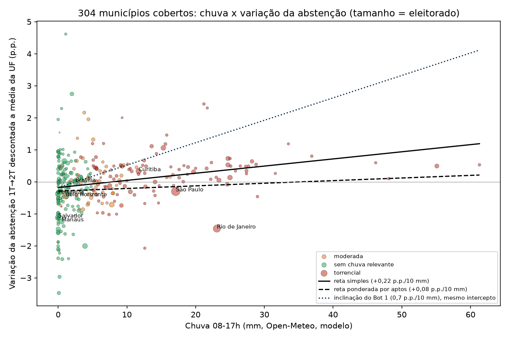
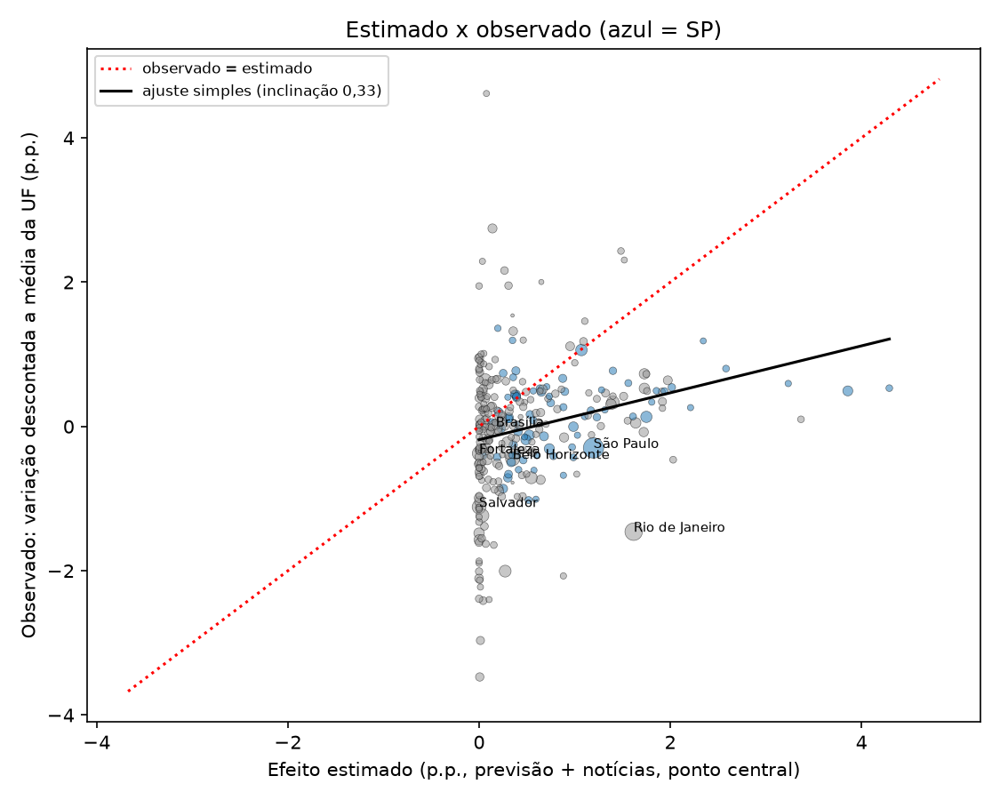

# Chuva x abstenção no 2º turno de 2026: estimativa do projeto vs resultado oficial, por município

*Documento público do projeto, gerado por `scripts/pos_eleicao/gerar.py` a partir dos arquivos listados em Fontes, após a totalização final do TSE (25/10/2026, 23:26). Todos os números vêm desses arquivos. A estimativa comparada é a congelada às 17:09 BRT do dia da eleição, mantida sem alteração como registro histórico. Conclusão resumida em `CONCLUSAO.md`.*

> **Atenção:** a comparação usa a variação da abstenção do 1º para o 2º turno. Essa variação NÃO é a abstenção causada pela chuva: ela mistura tudo o que mudou entre os turnos (fim das disputas estaduais e proporcionais, mobilização, feriado, eleitores no exterior etc.). Descontar a média da UF remove o que é comum ao estado inteiro, mas não isola a chuva.

## 1. Método

- **Universo:** os 304 municípios cobertos pela estimativa final de 17:09 BRT (`impacto_agora_latest.json`, 9 ajustes por notícias ativos). Todos os 304 foram encontrados nos arquivos do TSE do 1º e do 2º turno; nenhum ficou de fora. Eles somam 85.908.193 eleitores aptos no 2º turno (54,1% do eleitorado nacional).
- **Abstenção 1º turno:** `data/tse/2026_1turno/abstencao_municipio.csv` (ABSTENCAO_2026 / APTOS_2026). **2º turno:** arquivos oficiais `tse_2t/ab_<uf>.json` do TSE (eleição 6258, totalização final, 100% das seções), conferidos um a um com o arquivo municipal de resultado `tse_2t/municipios/<uf><cód>-c0001-e006258-u.json` (aptos e abstenção idênticos nos 304).
- **Média da UF:** variação da abstenção do estado inteiro (todos os municípios, cobertos ou não): 1º turno de `abstencao_por_uf.csv`, 2º turno de `tse_2t/ab_2t.json`. **Variação descontada** = variação do município menos a da UF. **Abstenções acima/abaixo da média da UF (eleitores)** = variação descontada x aptos do 2º turno / 100.
- **Chuva:** acumulado 08-17h do Open-Meteo (modelo, não pluviômetro) usado no cálculo final. A coluna "chuva usada" aplica o piso dos ajustes por notícias (a = 20 mm, b = 5 mm).
- **Efeito estimado:** o número publicado no site e no dashboard ("previsão + notícias"): chuva usada x coeficiente do Bot 1 (0,04 / 0,07 / 0,10 p.p. por mm). Para referência, o CSV também traz o efeito por classe do Bot 4 (a: 1,2 / 2,0 / 3,0; b: 0,5 / 0,85 / 1,2; c: 0 / 0,15 / 0,4 p.p.).
- **Inclinação:** regressão da variação descontada sobre a chuva (mm), sem peso e com peso pelo eleitorado, com erro-padrão robusto (HC1) e intervalo de 95%. Inclinações apresentadas em p.p. por 10 mm.
- **Resultado do 2º turno por candidato:** votos e % de votos válidos de Flávio Bolsonaro (22) e Lula (13) nos arquivos municipais do TSE.

## 2. Resumo nacional e por UF

- **Abstenção nacional (TSE, inclui exterior):** 21,08% no 1º turno para 19,22% no 2º turno (−1,87 p.p.). Sem o exterior: 20,84% para 18,99% (−1,85 p.p.).
- **Nos 304 municípios cobertos:** 20,76% para 18,60% (−2,17 p.p.).
- **Estimativa final do projeto (17:09 BRT, previsão + notícias):** +0,34 p.p. na abstenção nacional (faixa +0,19 a +0,48), cerca de 538.510 abstenções extras (307.720 a 769.300). Só previsão: 522.894. O rascunho interno anterior (não publicado) citava 523 mil e +0,33 p.p.; os valores do arquivo final são os acima.
- **Soma das abstenções acima/abaixo da média da UF nos 304:** −187.621 eleitores (estimado: 538.508). Ou seja, os municípios cobertos, em conjunto, reduziram a abstenção um pouco mais que os seus estados.

| UF | Abst. 1T % | Abst. 2T % | Variação UF (p.p.) | Municípios cobertos | Aptos cobertos | Chuva média pond. (mm) | Efeito estimado pond. (p.p.) | Var. descontada pond. dos cobertos (p.p.) |
|---|---|---|---|---|---|---|---|---|
| SP | 22,54 | 19,81 | −2,73 | 76 | 25.655.395 | 14,0 | +0,99 | −0,02 |
| MG | 22,81 | 20,33 | −2,49 | 31 | 6.996.260 | 4,6 | +0,40 | +0,04 |
| RJ | 23,32 | 21,62 | −1,69 | 28 | 11.223.972 | 20,6 | +1,44 | −0,21 |
| BA | 19,97 | 16,71 | −3,26 | 18 | 4.448.877 | 0,0 | +0,00 | −0,72 |
| PR | 20,57 | 18,04 | −2,53 | 22 | 4.378.679 | 9,6 | +0,86 | +0,15 |
| RS | 21,35 | 19,16 | −2,19 | 19 | 3.892.547 | 6,4 | +0,45 | −0,24 |
| PE | 18,17 | 15,18 | −2,98 | 14 | 3.616.629 | 0,5 | +0,03 | +0,18 |
| CE | 15,52 | 13,89 | −1,63 | 8 | 2.860.830 | 0,0 | +0,00 | −0,17 |
| PA | 19,10 | 20,32 | +1,22 | 14 | 2.953.524 | 2,1 | +0,15 | −1,13 |
| SC | 18,95 | 16,96 | −1,99 | 15 | 2.552.902 | 3,1 | +0,22 | −0,00 |
| MA | 19,73 | 20,36 | +0,63 | 8 | 1.576.775 | 2,3 | +0,16 | −0,69 |
| GO | 21,83 | 20,34 | −1,49 | 10 | 2.431.811 | 2,6 | +0,18 | −0,18 |
| PB | 17,38 | 15,54 | −1,84 | 3 | 1.000.504 | 0,8 | +0,06 | −0,22 |
| ES | 21,37 | 19,47 | −1,91 | 9 | 1.789.125 | 3,8 | +0,27 | −0,01 |
| AM | 20,16 | 21,67 | +1,52 | 2 | 1.558.192 | 0,5 | +0,04 | −1,05 |
| PI | 17,15 | 17,19 | +0,04 | 2 | 711.380 | 0,1 | +0,01 | −1,05 |
| RN | 18,38 | 16,06 | −2,32 | 4 | 986.310 | 0,2 | +0,01 | −1,00 |
| MT | 22,20 | 20,95 | −1,26 | 4 | 956.266 | 1,1 | +0,08 | −0,19 |
| AL | 20,63 | 20,08 | −0,54 | 2 | 805.389 | 0,0 | +0,00 | −1,58 |
| DF | 18,90 | 17,30 | −1,61 | 1 | 2.258.995 | 2,5 | +0,17 | +0,00 |
| MS | 23,87 | 21,24 | −2,63 | 3 | 896.533 | 16,5 | +1,16 | −0,16 |
| SE | 17,30 | 15,71 | −1,59 | 3 | 628.390 | 0,0 | +0,00 | −0,42 |
| RO | 21,71 | 21,92 | +0,21 | 2 | 465.846 | 0,0 | +0,00 | +0,60 |
| TO | 18,34 | 19,23 | +0,88 | 2 | 343.955 | 1,2 | +0,08 | −0,81 |
| ZZ | 62,71 | 58,34 | −4,37 | 0 | - | - | - | - |
| AC | 20,43 | 26,08 | +5,65 | 1 | 270.119 | 0,1 | +0,01 | −3,47 |
| AP | 17,41 | 25,47 | +8,06 | 2 | 407.425 | 0,0 | +0,00 | −2,06 |
| RR | 17,12 | 23,15 | +6,02 | 1 | 241.563 | 0,2 | +0,01 | −2,97 |

No nível estadual não aparece efeito da chuva: a correlação entre o efeito estimado ponderado da UF e a variação da UF é −0,36 (UFs com município coberto, exterior fora). AP, RR, AC e AM tiveram as maiores altas de abstenção sem chuva relevante estimada, o que indica fatores não ligados à chuva, não analisados aqui.

## 3. Faixas de chuva (08-17h, mm)

| Faixa (mm) | n | Aptos | Chuva média | Variação média (p.p.) | Var. descontada, média simples | Var. descontada, média pond. | Efeito estimado pond. (projeto) | Efeito por classe Bot 4 pond. | Abst. extras estimadas | Abst. observadas acima da média da UF |
|---|---|---|---|---|---|---|---|---|---|---|
| 0 a 1 | 97 | 22.575.822 | 0,3 | −1,69 | −0,33 | −0,53 | +0,02 | +0,17 | 3.953 | −118.976 |
| 1 a 5 | 79 | 21.149.560 | 2,7 | −1,83 | +0,02 | −0,11 | +0,22 | +0,39 | 47.251 | −23.255 |
| 5 a 15 | 81 | 17.802.572 | 8,6 | −2,42 | +0,04 | +0,03 | +0,66 | +1,67 | 117.390 | +5.512 |
| 15 a 30 | 40 | 23.240.111 | 21,8 | −1,79 | +0,42 | −0,24 | +1,42 | +1,99 | 330.657 | −56.929 |
| 30 ou mais | 7 | 1.140.128 | 44,7 | −2,13 | +0,57 | +0,53 | +3,44 | +2,00 | 39.257 | +6.027 |

Na média simples, a variação descontada sobe com a chuva (municípios sem chuva tiveram queda maior de abstenção que o seu estado). Na média ponderada pelo eleitorado o padrão é fraco e não monotônico: a faixa de 15 a 30 mm, que reúne São Paulo e Rio de Janeiro, fica abaixo de zero.

## 4. Inclinação (p.p. por 10 mm de chuva)

| Amostra | n | Modelo | Peso por eleitorado | Inclinação | IC 95% | p-valor | R² |
|---|---|---|---|---|---|---|---|
| Todos (304) | 304 | simples | não | +0,223 | +0,137 a +0,310 | 0,000 | 0,056 |
| Todos (304) | 304 | simples | sim (aptos) | +0,082 | −0,175 a +0,339 | 0,532 | 0,009 |
| Todos (304) | 304 | controle de porte (log aptos) | não | +0,230 | +0,144 a +0,316 | 0,000 | 0,075 |
| Todos (304) | 304 | controle de porte (log aptos) | sim (aptos) | +0,176 | +0,002 a +0,350 | 0,048 | 0,119 |
| Só SP | 76 | simples | não | +0,141 | +0,069 a +0,213 | 0,000 | 0,102 |
| Só SP | 76 | simples | sim (aptos) | +0,078 | −0,020 a +0,175 | 0,120 | 0,029 |
| Só SP | 76 | controle de porte (log aptos) | não | +0,138 | +0,066 a +0,211 | 0,000 | 0,107 |
| Só SP | 76 | controle de porte (log aptos) | sim (aptos) | +0,133 | +0,079 a +0,188 | 0,000 | 0,252 |
| Só PR | 22 | simples | não | −0,027 | −0,296 a +0,242 | 0,843 | 0,001 |
| Só PR | 22 | simples | sim (aptos) | +0,021 | −0,203 a +0,246 | 0,853 | 0,001 |
| Só PR | 22 | controle de porte (log aptos) | não | +0,016 | −0,245 a +0,276 | 0,907 | 0,093 |
| Só PR | 22 | controle de porte (log aptos) | sim (aptos) | +0,010 | −0,218 a +0,237 | 0,934 | 0,013 |
| Todos, efeito fixo de UF (cobertos) | 304 | var. bruta ~ chuva + UF | não | +0,032 | −0,055 a +0,118 | 0,470 | 0,754 |
| Todos, efeito fixo de UF (cobertos) | 304 | var. bruta ~ chuva + UF | sim (aptos) | −0,078 | −0,281 a +0,124 | 0,448 | 0,731 |

- **Sem peso:** +0,223 p.p. por 10 mm (IC 95% +0,137 a +0,310), estatisticamente diferente de zero. Correlação chuva x variação descontada: 0,24.
- **Ponderado por eleitorado:** +0,082 (IC −0,175 a +0,339), não distinguível de zero; com controle de porte, +0,176 (IC +0,002 a +0,350), no limite da significância. As grandes cidades pesam muito e divergem entre si (Rio de Janeiro bem abaixo da média do RJ; Guarulhos bem acima da média de SP).
- **SP (n = 76):** inclinação positiva e significativa nas versões sem peso e com controle de porte. **PR (n = 22):** sem relação detectável (IC amplo, em torno de zero). Outras UFs têm n pequeno demais para um subconjunto confiável.

## 5. Coeficiente estimado (Bot 1) x implícito

- **Coeficiente usado pelo projeto:** 0,07 p.p. por mm (0,7 p.p. por 10 mm; faixa 0,04 a 0,10).
- **Implícito (sem peso):** 0,0223 p.p. por mm, cerca de 32% do coeficiente do Bot 1; o IC 95% (0,0137 a 0,0310) fica abaixo até do limite inferior do Bot 1 (0,04).
- **Implícito (ponderado):** 0,0082 p.p. por mm (IC −0,0175 a 0,0339); com controle de porte, 0,0176.
- **Regressão observado sobre estimado** (ideal = inclinação 1): sem peso 0,33 (IC 0,20 a 0,45); ponderado 0,13 (IC −0,23 a 0,49). Para o efeito por classe do Bot 4: 0,26 sem peso e 0,14 ponderado. Correlação estimado x observado: 0,24.

## 6. Cidades em destaque

### São Paulo (SP)

| Indicador | Valor |
|---|---|
| Aptos 2º turno | 9.145.969 |
| Abstenção 1T → 2T | 23,39% → 20,36% (−3,03 p.p.) |
| Variação da UF | −2,73 p.p. |
| Variação descontada a média da UF | −0,30 p.p. (−27.252 eleitores) |
| Chuva 08-17h (modelo / usada) | 17,1 mm / 17,1 mm |
| Nível de risco (só previsão → final) | torrencial → torrencial |
| Ajuste por notícias | não |
| Efeito estimado (projeto) | +1,20 p.p. (0,68 a 1,71), 109.467 abstenções extras |
| Efeito por classe Bot 4 (mid) | +2,00 p.p. |
| Observado menos estimado | −1,49 p.p. |
| 2º turno (votos válidos) | Flávio 44,50% (3.097.923) · Lula 55,50% (3.864.354) |
| 1º turno (Flávio / Lula) | 42,13% / 46,58% |

### Rio de Janeiro (RJ)

| Indicador | Valor |
|---|---|
| Aptos 2º turno | 4.952.423 |
| Abstenção 1T → 2T | 26,12% → 22,97% (−3,15 p.p.) |
| Variação da UF | −1,69 p.p. |
| Variação descontada a média da UF | −1,46 p.p. (−72.243 eleitores) |
| Chuva 08-17h (modelo / usada) | 23,1 mm / 23,1 mm |
| Nível de risco (só previsão → final) | torrencial → torrencial |
| Ajuste por notícias | não |
| Efeito estimado (projeto) | +1,62 p.p. (0,92 a 2,31), 80.084 abstenções extras |
| Efeito por classe Bot 4 (mid) | +2,00 p.p. |
| Observado menos estimado | −3,08 p.p. |
| 2º turno (votos válidos) | Flávio 48,46% (1.785.198) · Lula 51,54% (1.898.391) |
| 1º turno (Flávio / Lula) | 47,88% / 43,91% |

### Guarulhos (SP)

| Indicador | Valor |
|---|---|
| Aptos 2º turno | 948.903 |
| Abstenção 1T → 2T | 19,25% → 17,58% (−1,67 p.p.) |
| Variação da UF | −2,73 p.p. |
| Variação descontada a média da UF | +1,06 p.p. (+10.059 eleitores) |
| Chuva 08-17h (modelo / usada) | 15,3 mm / 15,3 mm |
| Nível de risco (só previsão → final) | torrencial → torrencial |
| Ajuste por notícias | não |
| Efeito estimado (projeto) | +1,07 p.p. (0,61 a 1,53), 10.163 abstenções extras |
| Efeito por classe Bot 4 (mid) | +2,00 p.p. |
| Observado menos estimado | −0,01 p.p. |
| 2º turno (votos válidos) | Flávio 51,09% (380.962) · Lula 48,91% (364.761) |
| 1º turno (Flávio / Lula) | 49,22% / 40,21% |

### Campinas (SP)

| Indicador | Valor |
|---|---|
| Aptos 2º turno | 873.566 |
| Abstenção 1T → 2T | 23,57% → 20,97% (−2,60 p.p.) |
| Variação da UF | −2,73 p.p. |
| Variação descontada a média da UF | +0,13 p.p. (+1.164 eleitores) |
| Chuva 08-17h (modelo / usada) | 25,0 mm / 25,0 mm |
| Nível de risco (só previsão → final) | torrencial → torrencial |
| Ajuste por notícias | sim, nível a, confiança media |
| Efeito estimado (projeto) | +1,75 p.p. (1,00 a 2,50), 15.288 abstenções extras |
| Efeito por classe Bot 4 (mid) | +2,00 p.p. |
| Observado menos estimado | −1,62 p.p. |
| 2º turno (votos válidos) | Flávio 54,24% (360.222) · Lula 45,76% (303.914) |
| 1º turno (Flávio / Lula) | 52,07% / 38,21% |

*Evidência registrada (ajustes_impacto_noticias.csv, 2026-10-25 11:50):* Rua do Colégio Notre Dame (Sousas, 2.354 eleitores) alagada e acesso a locais de votação dificultado por alagamentos e queda de árvores; Defesa Civil: 83 mm acumulados. TRE-SP diz que a votação flui normalmente e há local de contingência (sem transferência). Já 'a' pela previsão; ajuste confirma com evidência observada.

### Belo Horizonte (MG)

| Indicador | Valor |
|---|---|
| Aptos 2º turno | 1.966.758 |
| Abstenção 1T → 2T | 23,61% → 20,67% (−2,94 p.p.) |
| Variação da UF | −2,49 p.p. |
| Variação descontada a média da UF | −0,45 p.p. (−8.833 eleitores) |
| Chuva 08-17h (modelo / usada) | 1,1 mm / 5,0 mm |
| Nível de risco (só previsão → final) | sem_chuva_relevante → moderada |
| Ajuste por notícias | sim, nível b, confiança alta |
| Efeito estimado (projeto) | +0,35 p.p. (0,20 a 0,50), 6.884 abstenções extras |
| Efeito por classe Bot 4 (mid) | +0,85 p.p. |
| Observado menos estimado | −0,80 p.p. |
| 2º turno (votos válidos) | Flávio 50,80% (765.311) · Lula 49,20% (741.128) |
| 1º turno (Flávio / Lula) | 48,30% / 41,39% |

*Evidência registrada (ajustes_impacto_noticias.csv, 2026-10-25 15:45):* Atualização 15:45 BRT: além da chuva forte observada (Defesa Civil de BH: 7 a 26 mm em 2h até 13h45; alertas severos de enxurrada, alagamento e granizo), a Rádio Itatiaia (15h09) informa alteração emergencial de seções de votação de uma escola de BH destelhada pelo temporal, para segurança de eleitores e mesários (escola e novo endereço não divulgados; consultar TRE-MG/e-Título). Mantido em b; con...

### Curitiba (PR)

| Indicador | Valor |
|---|---|
| Aptos 2º turno | 1.415.021 |
| Abstenção 1T → 2T | 19,72% → 17,52% (−2,20 p.p.) |
| Variação da UF | −2,53 p.p. |
| Variação descontada a média da UF | +0,33 p.p. (+4.704 eleitores) |
| Chuva 08-17h (modelo / usada) | 11,7 mm / 20,0 mm |
| Nível de risco (só previsão → final) | torrencial → torrencial |
| Ajuste por notícias | sim, nível a, confiança alta |
| Efeito estimado (projeto) | +1,40 p.p. (0,80 a 2,00), 19.812 abstenções extras |
| Efeito por classe Bot 4 (mid) | +2,00 p.p. |
| Observado menos estimado | −1,07 p.p. |
| 2º turno (votos válidos) | Flávio 62,29% (702.244) · Lula 37,71% (425.092) |
| 1º turno (Flávio / Lula) | 57,50% / 30,37% |

*Evidência registrada (ajustes_impacto_noticias.csv, 2026-10-25 07:52):* TRE-PR transferiu 3.523 eleitores (10 seções) da E.M. Dario Persiano de Castro Vellozo (CIC), alagada pela chuva recorde de sábado (106,6 mm, Simepar), para o CEI Hugo Peretti; INMET laranja (tempestade) vigente no domingo

### Municípios com ajuste por notícias (9)

| Município | UF | Aptos | Confiança | Chuva modelo / usada (mm) | Estimado (p.p.) | Observado descontado (p.p.) | Abst. extras estimadas | Abst. acima da média da UF |
|---|---|---|---|---|---|---|---|---|
| Belo Horizonte | MG | 1.966.758 | alta | 1,1 / 5,0 | +0,35 | −0,45 | 6.884 | −8.833 |
| Curitiba | PR | 1.415.021 | alta | 11,7 / 20,0 | +1,40 | +0,33 | 19.812 | +4.704 |
| Campinas | SP | 873.566 | media | 25,0 / 25,0 | +1,75 | +0,13 | 15.288 | +1.164 |
| Itapevi | SP | 168.601 | alta | 3,3 / 20,0 | +1,40 | +0,77 | 2.361 | +1.301 |
| Prudentópolis | PR | 39.044 | media | 9,3 / 9,3 | +0,65 | +2,00 | 254 | +782 |
| Guaratuba | PR | 32.487 | media | 6,2 / 6,2 | +0,43 | +0,13 | 141 | +43 |
| Barracão | PR | 7.591 | media | 0,2 / 5,0 | +0,35 | +1,54 | 27 | +117 |
| São Domingos | SC | 7.346 | alta | 2,4 / 5,0 | +0,35 | −1,04 | 26 | −76 |
| Águas de Chapecó | SC | 4.732 | media | 0,5 / 5,0 | +0,35 | −0,78 | 17 | −37 |

### Itapevi (SP)

| Indicador | Valor |
|---|---|
| Aptos 2º turno | 168.601 |
| Abstenção 1T → 2T | 24,41% → 22,45% (−1,96 p.p.) |
| Variação da UF | −2,73 p.p. |
| Variação descontada a média da UF | +0,77 p.p. (+1.301 eleitores) |
| Chuva 08-17h (modelo / usada) | 3,3 mm / 20,0 mm |
| Nível de risco (só previsão → final) | moderada → torrencial |
| Ajuste por notícias | sim, nível a, confiança alta |
| Efeito estimado (projeto) | +1,40 p.p. (0,80 a 2,00), 2.361 abstenções extras |
| Efeito por classe Bot 4 (mid) | +2,00 p.p. |
| Observado menos estimado | −0,63 p.p. |
| 2º turno (votos válidos) | Flávio 43,36% (54.371) · Lula 56,64% (71.036) |
| 1º turno (Flávio / Lula) | 41,87% / 47,23% |

*Evidência registrada (ajustes_impacto_noticias.csv, 2026-10-25 09:20):* TRE-SP fez transferência emergencial na manhã do 2º turno das seções 439 e 474 (359ª ZE) do Cemeb Prof. Edevaldo Caramez, inacessível por alagamento após chuva forte, para a Escola do Futuro ETI Prof. Irany Toledo de Moraes (Jd. Santa Rita); INMET laranja vigente

### Prudentópolis (PR)

| Indicador | Valor |
|---|---|
| Aptos 2º turno | 39.044 |
| Abstenção 1T → 2T | 18,46% → 17,94% (−0,53 p.p.) |
| Variação da UF | −2,53 p.p. |
| Variação descontada a média da UF | +2,00 p.p. (+782 eleitores) |
| Chuva 08-17h (modelo / usada) | 9,3 mm / 9,3 mm |
| Nível de risco (só previsão → final) | torrencial → torrencial |
| Ajuste por notícias | sim, nível b, confiança media |
| Efeito estimado (projeto) | +0,65 p.p. (0,37 a 0,93), 254 abstenções extras |
| Efeito por classe Bot 4 (mid) | +2,00 p.p. |
| Observado menos estimado | +1,35 p.p. |
| 2º turno (votos válidos) | Flávio 74,76% (23.334) · Lula 25,24% (7.878) |
| 1º turno (Flávio / Lula) | 71,36% / 20,52% |

*Evidência registrada (ajustes_impacto_noticias.csv, 2026-10-25 17:15):* Alagamentos dificultaram acesso a locais de votação: urnas levadas por moto, trator e barco (Taboão, Rio do Meio, Barra Seca, Patos Velhos); mesários e eleitores atravessaram rio de barco; ~2,5 mil pessoas afetadas (Defesa Civil Estadual). Fotos do Fórum Eleitoral de Prudentópolis.

### Guaratuba (PR)

| Indicador | Valor |
|---|---|
| Aptos 2º turno | 32.487 |
| Abstenção 1T → 2T | 25,79% → 23,40% (−2,40 p.p.) |
| Variação da UF | −2,53 p.p. |
| Variação descontada a média da UF | +0,13 p.p. (+43 eleitores) |
| Chuva 08-17h (modelo / usada) | 6,2 mm / 6,2 mm |
| Nível de risco (só previsão → final) | torrencial → torrencial |
| Ajuste por notícias | sim, nível b, confiança media |
| Efeito estimado (projeto) | +0,43 p.p. (0,25 a 0,62), 141 abstenções extras |
| Efeito por classe Bot 4 (mid) | +2,00 p.p. |
| Observado menos estimado | −0,30 p.p. |
| 2º turno (votos válidos) | Flávio 66,38% (16.133) · Lula 33,62% (8.170) |
| 1º turno (Flávio / Lula) | 63,56% / 28,27% |

*Evidência registrada (ajustes_impacto_noticias.csv, 2026-10-25 07:52):* TRE-PR transferiu 222 eleitores de Guaratuba para salão paroquial por impacto das chuvas (não estava na lista de risco da previsão)

### Barracão (PR)

| Indicador | Valor |
|---|---|
| Aptos 2º turno | 7.591 |
| Abstenção 1T → 2T | 19,62% → 18,63% (−0,99 p.p.) |
| Variação da UF | −2,53 p.p. |
| Variação descontada a média da UF | +1,54 p.p. (+117 eleitores) |
| Chuva 08-17h (modelo / usada) | 0,2 mm / 5,0 mm |
| Nível de risco (só previsão → final) | sem_chuva_relevante → moderada |
| Ajuste por notícias | sim, nível b, confiança media |
| Efeito estimado (projeto) | +0,35 p.p. (0,20 a 0,50), 27 abstenções extras |
| Efeito por classe Bot 4 (mid) | +0,85 p.p. |
| Observado menos estimado | +1,19 p.p. |
| 2º turno (votos válidos) | Flávio 56,87% (3.450) · Lula 43,13% (2.617) |
| 1º turno (Flávio / Lula) | 54,81% / 39,14% |

*Evidência registrada (ajustes_impacto_noticias.csv, 2026-10-25 08:15):* TRE-PR realocou ~3,2 mil eleitores (seções 1–6, 74, 117, 129, 131) da Escola Leonor Castellano, danificada por temporal (destelhamento, fiação), para o Centro Comunitário da Igreja Católica, em frente; Defesa Civil PR confirma danos (via CNN). Não estava na lista de risco da previsão. Correção 09:50 BRT: nota do TRE-PR é de 23/10 (temporal de sexta), não do dia da eleição; mantido em b com confian...

### São Domingos (SC)

| Indicador | Valor |
|---|---|
| Aptos 2º turno | 7.346 |
| Abstenção 1T → 2T | 16,98% → 13,95% (−3,03 p.p.) |
| Variação da UF | −1,99 p.p. |
| Variação descontada a média da UF | −1,04 p.p. (−76 eleitores) |
| Chuva 08-17h (modelo / usada) | 2,4 mm / 5,0 mm |
| Nível de risco (só previsão → final) | sem_chuva_relevante → moderada |
| Ajuste por notícias | sim, nível b, confiança alta |
| Efeito estimado (projeto) | +0,35 p.p. (0,20 a 0,50), 26 abstenções extras |
| Efeito por classe Bot 4 (mid) | +0,85 p.p. |
| Observado menos estimado | −1,39 p.p. |
| 2º turno (votos válidos) | Flávio 63,97% (3.940) · Lula 36,03% (2.219) |
| 1º turno (Flávio / Lula) | 62,88% / 32,42% |

*Evidência registrada (ajustes_impacto_noticias.csv, 2026-10-25 11:50):* TRE-SC (49ª ZE) transferiu no sábado (24) as seções 173, 174 e 175 (621 eleitores) do Centro de Convivência Flor de Araucária, alagado, para o Centro de Assistência Social (antigo Fórum, R. Major Azambuja, 138), a ~500 m do local original. Não estava na lista de risco da previsão.

### Águas de Chapecó (SC)

| Indicador | Valor |
|---|---|
| Aptos 2º turno | 4.732 |
| Abstenção 1T → 2T | 18,17% → 15,41% (−2,77 p.p.) |
| Variação da UF | −1,99 p.p. |
| Variação descontada a média da UF | −0,78 p.p. (−37 eleitores) |
| Chuva 08-17h (modelo / usada) | 0,5 mm / 5,0 mm |
| Nível de risco (só previsão → final) | sem_chuva_relevante → moderada |
| Ajuste por notícias | sim, nível b, confiança media |
| Efeito estimado (projeto) | +0,35 p.p. (0,20 a 0,50), 17 abstenções extras |
| Efeito por classe Bot 4 (mid) | +0,85 p.p. |
| Observado menos estimado | −1,13 p.p. |
| 2º turno (votos válidos) | Flávio 52,76% (2.063) · Lula 47,24% (1.847) |
| 1º turno (Flávio / Lula) | 52,96% / 41,12% |

*Evidência registrada (ajustes_impacto_noticias.csv, 2026-10-25 17:15):* Corpo de Bombeiros transportou de barco 9 eleitores ilhados por alagamento para que pudessem votar no 2º turno (Oeste de SC); município incluído no pedido de prorrogação por chuva ao TSE. Não estava na lista de risco da previsão.

Resumo dos ajustes: 6 de 9 municípios ajustados tiveram abstenção acima da média do seu estado; estimado somado 44.810 abstenções extras, observado acima da média da UF somado −835 (Belo Horizonte puxa para baixo).

## 7. Municípios com 30 mm ou mais

| Município | UF | Aptos | Chuva (mm) | Variação (p.p.) | Var. descontada (p.p.) | Estimado (p.p.) | Observado menos estimado |
|---|---|---|---|---|---|---|---|
| Mogi Guaçu | SP | 114.331 | 61,3 | −2,20 | +0,53 | +4,29 | −3,76 |
| São José dos Campos | SP | 540.171 | 55,1 | −2,24 | +0,49 | +3,86 | −3,36 |
| Pouso Alegre | MG | 112.431 | 48,1 | −2,39 | +0,10 | +3,37 | −3,27 |
| Guaratinguetá | SP | 90.832 | 46,2 | −2,14 | +0,60 | +3,23 | −2,64 |
| Pindamonhangaba | SP | 119.294 | 36,9 | −1,93 | +0,80 | +2,58 | −1,78 |
| Ubatuba | SP | 77.907 | 33,5 | −1,55 | +1,19 | +2,35 | −1,16 |
| Itatiba | SP | 85.162 | 31,6 | −2,47 | +0,26 | +2,21 | −1,95 |

7 municípios; 7 tiveram abstenção acima da média da UF, mas em todos o observado ficou abaixo do estimado (média observada +0,57 p.p. contra estimado +3,13 p.p.).

## 8. Maiores erros (observado descontado menos estimado, p.p.)

**Observado muito ABAIXO do estimado (o modelo superestimou)**

| Município | UF | Aptos | Chuva usada (mm) | Estimado | Observado descontado | Erro |
|---|---|---|---|---|---|---|
| Mogi Guaçu | SP | 114.331 | 61,3 | +4,29 | +0,53 | −3,76 |
| Rio Branco | AC | 270.119 | 0,1 | +0,01 | −3,47 | −3,48 |
| São José dos Campos | SP | 540.171 | 55,1 | +3,86 | +0,49 | −3,36 |
| Pouso Alegre | MG | 112.431 | 48,1 | +3,37 | +0,10 | −3,27 |
| Rio de Janeiro | RJ | 4.952.423 | 23,1 | +1,62 | −1,46 | −3,08 |
| Boa Vista | RR | 241.563 | 0,2 | +0,01 | −2,97 | −2,98 |
| Três Lagoas | MS | 88.514 | 12,6 | +0,88 | −2,07 | −2,95 |
| Guaratinguetá | SP | 90.832 | 46,2 | +3,23 | +0,60 | −2,64 |
| Ituiutaba | MG | 77.496 | 1,5 | +0,10 | −2,40 | −2,50 |
| Poços de Caldas | MG | 122.822 | 29,0 | +2,03 | −0,46 | −2,49 |

**Observado muito ACIMA do estimado (o modelo subestimou)**

| Município | UF | Aptos | Chuva usada (mm) | Estimado | Observado descontado | Erro |
|---|---|---|---|---|---|---|
| Breves | PA | 77.299 | 1,1 | +0,08 | +4,62 | +4,54 |
| Campos dos Goytacazes | RJ | 370.463 | 2,0 | +0,14 | +2,75 | +2,61 |
| Manacapuru | AM | 81.117 | 0,5 | +0,04 | +2,29 | +2,25 |
| Itapipoca | CE | 103.239 | 0,0 | +0,00 | +1,95 | +1,95 |
| Macaé | RJ | 186.272 | 3,8 | +0,27 | +2,16 | +1,90 |
| Cabo Frio | RJ | 179.584 | 4,4 | +0,31 | +1,95 | +1,64 |
| Prudentópolis | PR | 39.044 | 9,3 | +0,65 | +2,00 | +1,35 |
| Barracão | PR | 7.591 | 5,0 | +0,35 | +1,54 | +1,19 |
| Jaú | SP | 98.733 | 2,8 | +0,20 | +1,36 | +1,16 |
| Coronel Fabriciano | MG | 79.959 | 0,3 | +0,02 | +1,00 | +0,98 |

Entre os 10 casos em que o modelo mais superestimou, 6 tinham 20 mm ou mais de chuva usada (erro ligado ao coeficiente alto); os demais (Rio Branco, Boa Vista, Três Lagoas, Ituiutaba) tiveram, com no máximo 12,6 mm, queda de abstenção bem maior que a do estado, o que aponta para fatores locais não ligados à chuva. Os 10 casos em que o modelo mais subestimou tinham no máximo 9,3 mm de chuva usada: ali o desvio não vem da chuva modelada (exceções possíveis: Prudentópolis e Barracão, com relatos de problemas de acesso).

## 9. O que isso sugere para o modelo

1. **Direção confirmada, magnitude bem menor.** Mais chuva está associada a abstenção relativamente maior (sem peso, +0,22 p.p. por 10 mm), mas o coeficiente implícito (0,022 p.p./mm) é cerca de um terço do usado (0,07) e fica abaixo da faixa do Bot 1 (0,04 a 0,10). Uma recalibração (sugestão para discussão) para algo em torno de 0,02 p.p./mm, com faixa de cerca de 0,01 a 0,03 (o IC sem peso), seria coerente com estes dados, com a ressalva de que é um único dia e uma medida indireta.
2. **Efeito por classe do Bot 4 alto demais.** Na faixa de 15 a 30 mm o efeito por classe estimava cerca de +2 p.p.; o observado ponderado foi negativo. A classe 'a' (+2,0 p.p.) não se sustenta como efeito médio.
3. **Grandes cidades dominam o total e divergem.** O resultado ponderado é instável: Rio de Janeiro (23,1 mm) ficou 1,46 p.p. abaixo da média do RJ e São Paulo (17,1 mm) 0,30 p.p. abaixo da média de SP, enquanto Guarulhos (15,3 mm) ficou 1,06 p.p. acima. O total nacional de abstenções extras fica muito sensível a poucas capitais.
4. **Ajustes por notícias: resultado misto.** 6 de 9 municípios ajustados ficaram acima da média da UF (maiores desvios: Prudentópolis +2,00 p.p., Barracão +1,54, Itapevi +0,77); Belo Horizonte (-0,45), São Domingos (-1,04, apesar da transferência de 621 eleitores) e Águas de Chapecó (-0,78) ficaram abaixo. Em Barracão a evidência registrada se refere a um temporal de 23/10, não ao dia da eleição. Com n = 9, não dá para concluir que os ajustes melhoraram a estimativa; em todos, exceto Prudentópolis e Barracão, o estimado ficou acima do observado.
5. **Para o próximo uso:** reduzir o coeficiente, aplicar o efeito só acima de um limiar de chuva, e validar com uma referência de comparecimento esperado melhor que o 1º turno (ex.: 2º turno de 2022 por município, ou controle por disputas estaduais).

## 10. Limitações

- A variação 1T→2T não é a abstenção causada pela chuva; descontar a média da UF não controla disputas locais, segundo turno estadual, perfil de renda nem mobilização.
- A média da UF inclui o próprio município; nas UFs dominadas pela capital (ex.: a capital tem 26,8% do eleitorado de SP e o Rio de Janeiro 38,5% do RJ) isso puxa a variação descontada para zero.
- Chuva é estimativa do modelo Open-Meteo (não pluviômetro), uma série por município, sem distribuição dentro da cidade.
- Os 304 municípios não são uma amostra aleatória (maiores colégios + ajustes); os resultados não valem para municípios pequenos.
- Um único dia de eleição: muita incerteza; os intervalos de confiança assumem independência entre municípios, o que a chuva (espacialmente correlacionada) viola.
- O eleitorado apto difere levemente entre os turnos (soma dos cobertos: 85.911.449 no 1T, 85.908.193 no 2T); as porcentagens usam o apto de cada turno.
- O rascunho interno anterior (não publicado) trazia números um pouco diferentes (faixas com n = 95/80/82/40/7 e inclinação +0,285 p.p. por 10 mm). Este documento recalculou tudo a partir dos arquivos oficiais (abstenção do 1º turno do arquivo TSE e do 2º turno dos JSON por UF); as faixas aqui usam a chuva do snapshot final, e os números deste documento substituem os do rascunho.
- Dois ajustes (Prudentópolis e Águas de Chapecó) têm registro às 17:15 no CSV de ajustes, mas já aparecem como ativos no snapshot de 17:09; o valor usado aqui é o do snapshot.

## 11. Fontes

- TSE, Divulgação de Resultados, eleição 6258 (2º turno, Presidente): https://resultados.tse.jus.br/oficial/ele2026/6258/dados/ (abstenção `<uf>/<uf>-e006258-ab.json` e resultado municipal `<uf>/<uf><código>-c0001-e006258-u.json`, totalização de 25/10/2026). Página pública: https://resultados.tse.jus.br
- 1º turno (TSE): `data/tse/2026_1turno/abstencao_municipio.csv` e `abstencao_por_uf.csv` (origem em `README_origem.md`).
- Estimativas finais (17:09 BRT): `data/impacto/atualizacoes/impacto_agora_latest.json` e `impacto_municipios_latest.csv`.
- Ajustes por notícias: `data/ajustes/ajustes_impacto_noticias.csv`.
- Repositório: https://github.com/andersonsoaresdev2025/chuva-abstencao-2turno-2026
- Dados derivados deste documento: `comparacao_municipios_2turno.csv` (uma linha por município, 304 linhas), `resumo.json` (números-chave usados no site e no dashboard) e os arquivos brutos do TSE em `tse_2t/`.